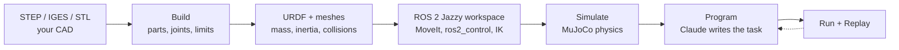

# Bob-ROS

**From a CAD file to a robot that moves under real physics.**

Drop in a STEP file of your arm. Bob-ROS finds the parts, works out the joints from the real geometry,
sweeps each joint until it hits something, and exports a URDF. It then generates a full ROS 2 / MoveIt
workspace and runs it against MuJoCo physics. Describe a task in plain words and Claude writes the program.
Watch the program run, and replay any run frame by frame.

It's a workshop app for hobbyists and small shops building their own robots.



---

## What it does

### Build: CAD to robot
- **Exact geometry, not guesses.** STEP files are read with OpenCascade, so every face knows its true surface
  type: plane, cylinder or sphere. Joint axes come from real cylinder axes, not from fitting triangles.
- **A guided wizard: Parts → Group → Connect → Review.** You pick the links, tie parts together, connect
  joints and set the base mount.
- **Joint limits found by collision.** Each joint is turned through its range until it first touches
  something. This uses FCL with a BVH that is built once and re-posed per step: about 3 ms for 120 steps on an
  82k-triangle pair.
- **Mass properties from the solid.** Mass, centre of mass and inertia are computed per link.
- **Convex decomposition.** CoACD splits each mesh into convex pieces for MuJoCo and MoveIt collisions.
- **Grippers.** Mark two finger joints and you get a parallel gripper that holds parts by contact and
  friction. Nothing is glued.
- **Import an existing robot.** Use File > Import URDF, from a `.urdf` or a zip with its meshes.

### Simulate: the same robot under physics
- **Generated ROS 2 Jazzy workspace.** You get MoveIt 2 (TRAC-IK, OMPL and Pilz planners), ros2_control and
  a planning scene kept in sync with the sim.
- **Closed-form IK for every solution.** [EAIK](https://github.com/OstermD/EAIK) derives an exact analytic
  solver straight from the URDF for 6R, 5R and 1–4R arms. It returns every solution: elbow up or down,
  wrist flipped or not. Checked on 200 random poses to 1e-6 m.
- **MuJoCo physics through `mujoco_ros2_control`.** Position actuators with gravity compensation, loose
  objects with friction, and a workcell editor for tables, posts and fixtures.
- **Same topics as real hardware.** A program runs unchanged on mock hardware or in physics.

### Program: tell it what to do
- **Claude writes the task program** against a small Python API, in Program mode.
- **Claude never writes the ROS, URDF or MoveIt files.** Those always come from tested templates.
- **Run replay.** Every run records joint states and object poses at 20 Hz. Replay redraws slips and drops
  exactly as they happened, even after the session stops.

A real acceptance program from the test suite: pick a 30 mm box off a post by squeezing it, and place it on
another post.

```python
from robot import Robot

r = Robot()
down = r.tool_down(yaw=0.0)                  # jaws close along x
r.release()
r.move_to((0.5, 0.0, 0.32), down)
r.move_line((0.5, 0.0, 0.195), down)         # fingertips beside the box
r.grip("box")                                # stops on the box: only friction holds it
r.move_line((0.5, 0.0, 0.32), down)
r.move_to((0.5, 0.2, 0.32), down)
r.move_line((0.5, 0.2, 0.197), down)
r.release()

(x, y, z), _ = r.pose("box")                 # where did it really land?
assert abs(x - 0.5) < 0.01 and abs(y - 0.2) < 0.01
```

The program API:

| Group  | Methods |
|--------|---------|
| Moves  | `move_to`, `move_line`, `move_joints`, `home` |
| Tool   | `tool_down`, `tool_facing`, `tool_pose`, `solutions` |
| Grip   | `grip`, `release`, `gripper_width` |
| Scene  | `add_box`, `add_cylinder`, `pose`, `reset` |

---

## Architecture

```
frontend/   React 18 + three.js viewer, CodeMirror 6 editor, rosbridge client
backend/    FastAPI: importers, joint inference, mass props, collision sweep, URDF export,
            ROS workspace generator (app/ros), MuJoCo scene builder, Program mode
docker/     ROS 2 Jazzy image (MoveIt, TRAC-IK, ros2_control, mujoco_ros2_control, EAIK, CoACD)
            plus the container checks for exported robots
scripts/    dev.ps1 (start both servers), ros_check.sh (check an export end to end)
docs/       design specs and implementation plans for each feature
```

| Layer | Built on |
|-------|----------|
| CAD kernel | `pythonocc-core` 7.8 (OpenCascade) and `trimesh` |
| Collision | `python-fcl`, CoACD |
| Kinematics | EAIK (analytic IK) and TRAC-IK (MoveIt plugin) |
| Motion | MoveIt 2, OMPL, Pilz, ros2_control on ROS 2 Jazzy |
| Physics | MuJoCo 3.x |
| Programs | Claude Code (`claude -p`), headless |
| UI | React, three.js, CodeMirror, Vite |

---

## Getting started

### You need
- **Python 3.11+** in a conda env. `pythonocc-core` comes from conda-forge.
- **Node.js 20+**.
- **Docker Desktop**, for Simulate and Program mode. The ROS image needs about 4 GB of free memory.
- **[Claude Code](https://claude.com/claude-code)** on your PATH, for Program mode.

### Install

```bash
# backend
conda create -n cad-to-urdf -c conda-forge python=3.11 pythonocc-core=7.8.1
conda activate cad-to-urdf
pip install -e "backend[dev]"

# frontend
cd frontend && npm ci

# ROS 2 image (first build takes a while)
docker build -t cad-to-urdf-jazzy docker/jazzy
```

### Run

On Windows, run `scripts/dev.ps1` to start both servers. To start them by hand:

```bash
# backend, from backend/
OPENBLAS_NUM_THREADS=1 python -m uvicorn app.main:app --port 8000

# frontend, from frontend/
npm run dev
```

Open **http://localhost:5173**. The frontend sends `/api` requests to the backend on port 8000.

> On some machines numpy's OpenBLAS crashes with many threads. Keep `OPENBLAS_NUM_THREADS=1`.

---

## Testing

```bash
# backend, from backend/ (about 2–3 min)
OPENBLAS_NUM_THREADS=1 python -m pytest -q

# frontend, from frontend/
npm test          # unit tests (vitest)
npm run e2e       # end-to-end tests (Playwright)

# full ROS + physics check of an exported robot (about 3 min per robot)
scripts/ros_check.sh path/to/export.zip
```

The container check builds the generated workspace inside ROS 2 Jazzy. It then checks:
- the controllers come up;
- TF is published;
- MoveIt can plan and execute;
- EAIK and TRAC-IK give matching answers;
- the physics acceptance programs pass. For example, a box must land within 1 cm of its target.

---

## Roadmap

1. **Projects:** New / Open / recent, each project in its own folder.
2. **Sensors:** cameras, depth, rangefinders, force-torque and IMU in MuJoCo, with real part data from
   Digi-Key. Programs read sensors instead of ground truth. Also a pneumatic gripper type.
3. **Cell logic + operator panel:** cycles, retries, alarms, part counter, and Start / Stop / Reset.
4. **Moving equipment:** conveyors, turntables, linear rails, pneumatic cylinders.
5. **Custom-robot hardware:**
   - Smart actuators first: Dynamixel, ODrive, moteus.
   - Then DIY electronics with generated firmware.
6. **Hardware readiness:** ABB virtual controller, safety checklist, regression runs, deployment images.
   The goal is a digital twin.
7. **Learn:**
   - Reinforcement learning (Gymnasium, PPO, MJX).
   - Learning from demonstration video.

---

## Notes

- Simulation is not safety. Nothing here certifies a real cell as safe. A software Stop is not an E-stop.
- LLMs never write ROS, URDF, MoveIt or firmware files here, and they never run inside the control loop.
